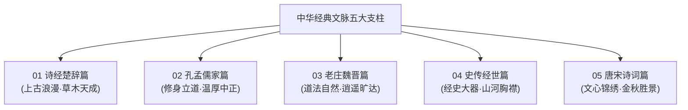

# 参考方法与评价框架

这份文档记录本项目参考的两套开源取名方法与两本书，并把其中适合杨姓宝宝的部分转成可执行规则。

> 说明：两个 GitHub 仓库已阅读其公开说明及核心规则文件；两本书依据公开书介、版本信息与可确认的方法概要整理。全库所有候选均严格遵循此框架进行硬伤排查、声韵检校与文脉深掘。

---

## 一、参考资料与核心启发

### 1. Chinese Name Evaluation Expert
- 仓库：[wuyax/chinese-name-evaluation-skill](https://github.com/wuyax/chinese-name-evaluation-skill)
- 主要贡献：把姓名拆为音韵、字义、字形、文化、社会传播、辨识度六个维度，并要求风险前置排查。
- 对本项目最有价值的提醒：
  - **必须连姓分析**，不能只评价名字两字（如“杨＋叶舟”速读有“野猪”音变，“杨＋嘉树”谐音“阳家属”，必须前置排除）；
  - **跨方言谐音排查**：重点排查普通话、莆仙方言与闽南方言白读谐音；
  - **全生命周期耐用性**：排查爆款网红感、低龄幼态感，确保成年后在学术、行政、商业与正式社交中皆具大家风范；
  - **字形平衡与系统友好**：笔画匀称，不选难打、生僻或证件易乱码的字。

### 2. Guofeng Qiming Skill
- 仓库：[mqyuhou/guofeng-qiming-skill](https://github.com/mqyuhou/guofeng-qiming-skill)
- 主要贡献：先收集气质、寓意、意象与纪念信息，形成命名简报；生成后再检查音律、字形、出处上下文和现代使用感。
- 对本项目最有价值的提醒：
  - **不确定的出处宁可不用**，绝不附会伪造；
  - **负面语境一律排除**：不从哀伤、怨怼、战败、死伤或讽刺等负面上下文中截取字词（如《采薇》征戍伤悲之“采薇”、《柏舟》忧苦怨刺之“柏舟”一律淘汰）；
  - **两字组合宜有层次**：一动一静、一景一意、一柔一骨，避免同义字无脑堆砌；
  - **国风不等于古偶**：现代日常可读性与耐用度是底线。

### 3. 《给孩子起个好名字》（李正明）
- 出版社：南开大学出版社（ISBN：9787310055814）
- 本项目采用其中四类实用技法：
  1. **离合**：从成熟典籍或成语中拆出具有内在呼应的两字（如“微澜”←“观水有术，必观其澜”）；
  2. **转意**：不照搬口语化字眼，转化为具备深层哲学品格的引申字（如“湉悦”←“人莫鉴于止水”之安流自悦）；
  3. **倒置**：原词在古代顺序不适合现代姓名时微调，保持典雅语义；
  4. **暗嵌**：不直接塞入“秋、十月、燕、雪”，而是以“月涵、雨霏、澄江、清嘉”等物候意象高雅致敬。

### 4. 《古人名字解诂》（吉常宏、吉发涵）
- 出版社：语文出版社 / 商务印书馆
- 本项目继承古人名与字“相协”的核心原则：
  - 名字里的两个字不能各讲各的，必须形成统一逻辑（同义相承、因果相接、意象相映）；
  - **双姓融合法则**：一律采用“杨X叶”正向结构，尾字“叶”必须深度参与完整语义与古典名句，绝不能作为孤立文字机械拼接（杜绝“杨叶X”倒置）。

---

## 二、五大经典文脉体系（The Five Pillars）

为彻底解决传统取名“来源杂糅、气质模糊”的问题，本项目将文献候选系统划分为中国文史哲公认的**“五大经典精神支柱”**，各篇文脉分明、气质各异：

### 1. 《诗经楚辞篇》：上古浪漫·草木天成
- **核心典籍**：《诗经》（风、雅、颂）、《楚辞》（离骚、九歌、九章、远游、天问）。
- **美学特质**：思无邪，上古自然生机，山川草木之灵，金玉君子之德。
- **代表候选**：杨清淇、杨清猗、杨涟漪、杨濯缨、杨洵美、杨伊露、杨叶清。

### 2. 《孔孟儒家篇》：修身立道·温厚中正
- **核心典籍**：《论语》《孟子》《大学》《中庸》《礼记》《荀子》。
- **哲学特质**：仁爱诚敬，见贤思齐，见微知著，讷言敏行，克己自牧，大雅君子。
- **代表候选**：杨微澜、杨清越、杨清沂、杨渊清、杨时雨、杨玉润。

### 3. 《老庄魏晋篇》：道法自然·逍遥旷达
- **核心典籍**：《老子》《庄子》（逍遥游、齐物论、秋水、大宗师）、《世说新语》（赏誉、雅量、容止）。
- **精神特质**：超然物外，抱朴守真，神姿高彻，清简要通，独立自适的名士风骨。
- **代表候选**：杨若水、杨善渊、杨澹宁、杨静泊、杨初荷、杨涵叶。

### 4. 《史传经世篇》：经史大器·山河胸襟
- **核心典籍**：《周易》《尚书》《左传》《国语》《战国策》《史记》《资治通鉴》。
- **气象特质**：历史纵深，刚健笃实，自强不息，经天纬地之担当，四海安澜之格局。
- **代表候选**：杨润禾、杨育泉、杨河清、杨清穆。

### 5. 《唐宋诗词篇》：文心锦绣·金秋胜景
- **核心典籍**：李白、杜甫、王维、白居易、刘禹锡、李商隐、杜牧、苏轼、柳永、朱熹等名篇。
- **文学意境**：声律清绝，文采斐然，深度交融十月深秋物候（秋水澄明、桂子飘香、霜叶似锦）。
- **代表候选**：杨清嘉（三秋桂子）、杨月涵、杨云霁、杨晴雨、杨溶月、杨岸芷、杨盈澈。

---

## 三、五行补水调候法则（第一权重·生辰定音后新增）

**生辰档案**：金秋十月（具体日期时辰仅家人掌握）。家人依生辰八字推论定调：**五行缺水，补水为取名第一纲领**（日柱精查以万年历为准，本库以家人结论为纲）。

- **家族五行妙合**：父姓杨（木）、母姓叶（木），双木林立；**水生木**——补水非但济命局之渴，更润双木家声，一人补水、全家得润；
- **补水选字**：优先氵、水、雨部及水德意象字（清、澄、澈、漪、汀、滢、溪、泉、雨、澜、泠、若水等），并讲究水木相生成局，忌满盘皆水；
- **补水红线**：泽、汐、霖、涵、浩、沫、沐等网红水字继续一票否决，补水绝不以烂大街为代价；
- **金秋彩蛋**：深秋雅称“菊月”，登高望远、秋水长天；补水名与水岸芳草的意象天然相合。

---

## 四、取名红线与评价法则

### 1. 坚决摒弃口语词与浅直组合
- **原则**：“名以表德，微言大义，言在此而意在彼”。
- **禁止**：
  - 严禁使用日常口语副词/形容词：如“从容”（过于浅白口语）、“舒怀”（动作过于直接）；
  - 严禁天气播报式词汇：如“初晴、天朗、秋晴”；
  - 严禁口号式道德词汇：如“慎思、审问、修齐”；
  - 严禁网红/古偶套路词：如“临风、静好、若曦、宸、诺”。

### 2. 父母双姓融合（杨＋叶）特别准则
- 必须有经典全句作为文脉支撑，使“叶”成为草木自然、生机繁盛或天人和协的有机组成部分；
- **通过名品**：
  - 《楚辞·湘夫人》“木叶下……秋波清” → **杨叶清**（秋水澄澈坦荡）；
  - 《九歌·湘夫人》“搴汀洲兮杜若” → **杨汀叶**（汀兰芳邻，水岸叶秀）；
  - “清扬婉兮”（《野有蔓草》）→ **杨清叶**（清扬其叶，双姓头牌）；
  - “涟漪”水泽映叶 → **杨滢叶**（滢水映叶，温润生光）；
  - “枝叶涵润”水意 → **杨涵叶**（涵润其叶，温厚大气）。
- **彻底淘汰**：
  - “杨叶舟”（谐音“野猪”）；
  - “杨叶新”（谐音“野心/液压油”）；
  - “杨叶晚”（谐音“杨夜晚”）；
  - “杨叶知”（谐音“叶汁”）。

### 3. 多方言发音与连姓谐音检验
- **连姓速读**：反复连读“杨＋名”，严防“杨”字引起的声调塌陷或变义；
- **莆仙方言与闽南方言审校**：
  - 排查“羊圈”（杨宽）、“羊汤”（杨棠）、“羊群/穷”（杨琼）、“羊脚”（杨皎）、“阳家属”（杨嘉树）、“有声书”（杨友声）等同音硬伤。

---

### 4. 严防名人光环压制与“替身效应”（一票否决）
- **核心原则**：“取其精神风骨，绝不当历史名家或现代公众人物的换姓替身”。姓名必须给予孩子真正独立、清白的心理空间与人格认同，免除成长过程中一辈子的解释负担。
- **排查标准**：
  - **历史重臣与大文豪重叠**：如“居正”（张居正）、“居易”（白居易）、“邦彦”（周邦彦）、“公望”（黄公望），国民认知度过大，给人明显的改姓借光之感，一票否决；
  - **近现代文化泰斗与才女重叠**：如“徽音”（民国才女林徽因的原名即林徽音）、“清源”（昭和棋圣吴清源），个人印记过深，一票否决；
  - **当代媒体焦点与公众人物重叠**：如“执中”（辩论名家黄执中），公众联想过于集中，一票否决。
- **高阶化用示范**：
  - 弃“徽音”，取补水正脉的**杨清婉**（清扬婉兮）或双姓**杨汀叶**（汀兰芳邻）；
  - 弃“执中/居正”，取**杨清鉴**（临水自鉴，公允端方）；
  - 弃“居易”，取**杨澄练**（澄江如练，行稳致远）；
  - 弃“清源”，取**杨源清**（正本清源，根底澄明）。

---

## 五、评价流程与等级分类

| 步骤 | 检验内容 | 一票否决项（出现即删除） |
| :--- | :--- | :--- |
| **第一步：硬伤前置** | 普通话/方言谐音、负面典故、生僻难写、历史名人重叠 | 负面谐音、字形畸形、悲凉背景 |
| **第二步：口头呼喊** | 家中连喊3遍、课堂点名、自我介绍、电话报名字 | 拗口缠绕、吞音、尾字声调疲软 |
| **第三步：意蕴审查** | 考察典故出处、微言大义、是否口语化 | 浮浅口语、口号标语、无真实出处 |
| **第四步：终身耐用** | 审查幼年、大学、职场、学术、退休全周期 | 过度幼态、古偶网文感、轻浮脂粉气 |

评级分为四档：**极品首选、可保留、备选谨慎、坚决淘汰**。不搞伪科学的百分制打分，专注于质感与真实生活体验。
