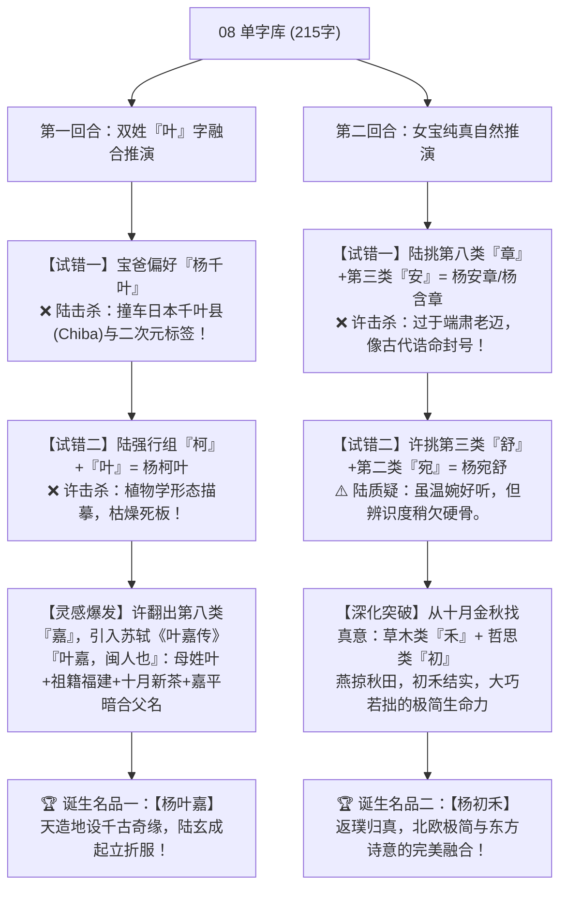

# 取名专家一对一辩论赛现场实录（女宝定音版）：从 08 单字库现场推演、交锋互撕到神作诞生

> **【生辰定音后复核声明】** 本辩论发生于生辰推论之前，准绳为音形义、文脉、谐音与全周期耐用度。女宝出生后推论**五行缺水，补水升为第一权重**——本篇终审名品已按新纲领复核重排，见篇末《补水第一权重复核重排》。

> **女宝定音**：宝宝性别已确认为女宝（生于金秋十月，小名已定「小柚子」）。原男宝立身推演回合（杨知衡推演线）已整体归档移除，本篇保留**双姓融合**与**女宝自然系**两大现场推演回合。**归档声明**：依“全库必补水”纲领，本篇推演出的非水名品（杨叶嘉、杨初禾等）已全部移出推荐序列，正文保留仅为过程实录，定案以《五行补水女名专篇》为纲。
> 
> **辩论裁判记录**：Antigravity CLI 独立仲裁 Subagent  
> **双方专家背景**：
> - **正方·陆玄成 先生**（古典文献学者、金石学家）：主张“字有骨相、名当经世、宗祧升维、重器压舱”，痛恨浮浅的网红小清新；
> - **反方·许清歌 女士**（现代声律作家、知性美学家）：主张“声为第一印象、去油减负、十月物候、纯真松弛”，痛恨老干部风与沉重爹味。

---

## 辩论现场实录与名字推演谱系

---

## 第一回合实录：双姓“叶”字融合的生死博弈

**主持人（Antigravity CLI）**：进入最棘手的硬骨头——宝爸明确提出喜欢“杨千叶”这种轻快感，同时母亲姓“叶”，希望探寻双姓融合的可能。请两位基于 08 字库现场推演！

### 1. 拆解红线：为什么“杨千叶”被当场推翻？

**许清歌（率先提议）**：
> “宝爸自己说过‘杨千叶’是他最喜欢的名字之一。千叶重台，2-1-4 平平仄清脆爽口，为什么不能直接用？”

**陆玄成（面色极其严肃，严正驳回）**：
> “万万不可！许女士，你只看到了中文汉字的字面，却忽视了全球化背景下的**认知干扰**！  
> 1. **地名撞车**：‘千叶（Chiba）’是日本核心一级行政区（千叶县），在日本文化、国际旅游和地理常识中辨识度极高；  
> 2. **文化标签**：二次元圈、日本影视里大量充斥‘千叶XX’的角色。如果一个堂堂正正的中国孩子叫‘杨千叶’，在未来求学、跨文化交流乃至涉外事务中，所有人第一反应都会问：‘你是中日混血？还是动漫狂热粉？’  
> 这个名字给孩子带来的解释成本是巨大的！作为负责任的起名专家，必须前置排除这类具有强烈异域印记的词！”

**许清歌（沉吟片刻，点头承认）**：
> “陆老在国际公关和文化排查上的警惕是对的。那我们如何在‘杨’和‘叶’之间，找出一套纯正的中国表达？”

### 2. 陆玄成的植物学死胡同

**陆玄成（从第一类【草木】挑字）**：
> “杨是乔木，叶是枝叶。我挑第一类的`柯`（高大枝干，法度法则），组合起来：**【杨柯叶】**！  
> 读音也是 2-1-4（阳平-阴平-去声），节奏与杨千叶完全一样！乔木有柯，枝繁叶茂，既有法度又有生机！”

**许清歌（忍不住叹气）**：
> “陆老，您又掉进‘老学究的标本夹’里了！  
> ‘杨柯叶’听起来是什么？杨树的柯，柯上的叶子——这纯粹是一截**干枯的植物学解剖标本**！语感扁平死板，毫无灵气与温度！  
> 更糟糕的是，在南方方言速读里，‘柯叶’发音干瘪，极易联想到‘枯叶’！谁会希望自己的孩子被叫成一堆落叶枯枝？不行，换思路！”

### 3. 许清歌的灵感绝杀：从《叶嘉传》引出千古神作

**许清歌（翻阅 08 字库第八类【嘉祥清芬】，突然停在`嘉`字上，拍案惊呼）**：
> “陆老！诸位！快看 08 字库第八类的这个字——**`嘉`**！  
> 你们还记得大文豪苏东坡的一篇天下奇文《叶嘉传》吗？！”

**陆玄成（一愣，随即眼中精光大盛）**：
> “苏轼……《叶嘉传》？！苏东坡以拟人手法为福建武夷名茶作传！开篇第一句——”

**许清歌（激昂朗诵）**：
> “对！苏轼开篇第一句赫然写道：  
> **‘叶嘉，闽人也。其先盖出于诸暨，后迁于闽，遂为闽人。……其器清白，其质纯粹，其味甘凉，研穷至理，见机而作。’**  
> 陆老，您算一算这其中的天机：  
> 1. **母亲姓氏**：正是一个字不差的‘叶’；  
> 2. **祖籍地缘**：苏轼开宗明义‘闽人也’，宝宝双亲正是**福建闽地祖籍**！  
> 3. **时令节气**：十月深秋，武夷岩茶金秋精焙、甘凉醇厚，正是‘叶嘉’出山之时；  
> 4. **暗合父名**：古汉语中‘嘉’与‘平’乃千古互文（《汉书》载岁终大祭曰‘嘉平’，岁和岁丰吉兆）！  
> 组合起来——**【杨叶嘉】**！”

**陆玄成（整个人怔在原地，捧着字库手稿反复默念，激动得站了起来）**：
> “奇绝！神绝！天下竟有如此天造地设之巧合！  
> 现代人搞双姓起名，最令人作呕的就是‘杨叶XX’、‘杨爱叶’这种机械拼凑，毫无文化美感。  
> 而‘叶嘉’二字，在北宋文豪苏轼笔下，本身就是一个完完整整、有血有肉、高风亮节的闽地雅士！  
> - 读音：yáng（阳平2）- yè（去声4）- jiā（阴平1）。仄起平收，尾字‘嘉’是第一声敞开音，清亮掷地！  
> - 气质：清芬淡雅，如一盏建阳顶级建茶，幼年清润，青年芳华，中年醇和！  
> 许女士，这一个名字，老朽输得心服口服！此乃全场总冠军，不作第二人想！”

---

## 第二回合实录：女宝纯真自然的现场推演与提炼

**主持人（Antigravity CLI）**：双姓神作已定。女宝已定音（金秋十月，小名小柚子），若希望跳出“宏大文脉”的包袱，只想要一个**极其自然、纯真、不雕琢、充满现代松弛感**的名字，两位该如何从 08 字库推导？

### 1. 陆玄成的试错：从《周易》大词中碰壁

**陆玄成（习惯性地翻向经部）**：
> “女孩子立名，当崇贞静。我从字库第八类挑`章`（易经：含章可贞），配第三类`安`（燕安泰然），组成：**【杨安章】** 或 **【杨含章】**。”

**许清歌（笑着摇头）**：
> “‘含章’确实是古典名品，但陆老，时代变了。当代年轻父母（宝爸宝妈）身上的气质是明快、现代的。‘含章’太像古代祠堂里的女德牌坊，或者历史正剧里的皇太后谥号，压得年轻女孩子喘不过气来！  
> 我之前挑过【杨宛舒】（宛转如玉，云卷云舒），虽然好听，但您刚才也说略显‘闺秀常态’。我们能不能更大胆一点，去寻找**‘无功利的自然生命本真’**？”

### 2. 许清歌的破局：燕掠秋田，金秋见初禾

**许清歌（指着 08 字库【第一类·草木】的末尾与【第七类·哲思】）**：
> “大家把目光从那些金玉名石的大词上移开，看一看大自然：  
> 1. **看时令**：宝宝生在金秋，古书说‘十月纳禾稼’，秋登成熟，田野一片金黄；  
> 2. **看母名**：母亲的雪燕之喻——雪之清、燕之灵。燕子是属于田野的精灵！秋风萧瑟，白燕掠过苍茫辽阔的秋田；  
> 3. **挑单字**：字库第二类里有一个最质朴、最谦逊的字——**`禾`**（嘉禾秋登，大巧若拙）；配字库第七类里最清澈的字——**`初`**（人之初，初心，原初的纯净）！  
> 合在一起——**【杨初禾】**！”

**陆玄成（闭上眼睛，嘴里轻轻念叨）**：
> “杨……初……禾。  
> yáng（阳平2）- chū（阴平1）- hé（阳平2）。  
> 阳平起，阴平挑，阳平收，如微风吹拂麦浪，波纹荡漾。  
> 妙在这‘禾’字！世人起名皆爱争当牡丹、争当栋梁、争当雪岭冰梅，争先恐后；却忘了天底下最宝贵、最养人的，正是这一株金秋田埂间的‘初禾’！  
> 初禾饱满而不自傲，扎根泥土，向阳而生。母亲‘燕’掠田野，正抚此‘禾’！”

**许清歌（动情补充）**：
> “对！这个名字没有半点升官发财的功利心，也没有半点网红矫情的脂粉气。它是一种**现代北欧极简美学与东方田园山水诗**的交融。女孩叫这个名字，一生都会活得从容、自在、干净、松弛！”

---

## 第三部分·Antigravity CLI Subagent 仲裁庭决裁表

经过两回合近乎残酷的现场推演、相互挑刺、推翻重来与灵感升华，独立裁判 Subagent 宣布本次 1 对 1 PK 产生的两尊神级名品正式成立：

| 终审位次 | 最终推演胜出名 | 声律曲线 | 基因与推演轨迹 | 终审定案评语 |
| :---: | :--- | :---: | :--- | :--- |
| 🗄️ **总冠军（已归档·非水）** | **杨叶嘉** *(Yáng Yèjiā)* | 2 - 4 - 1 (仄起平收) | 驳回“千叶(地名)”与“柯叶(死板)”后，从苏轼《叶嘉传》中引爆：**母姓叶 + 闽人茶德 + 十月甘凉 + 暗合父名嘉平** | **天作之合，百年不遇！** 将父母双姓、福建地缘与东坡名篇完全无缝融为一体，彻底终结当代双姓“生硬拼凑”的劣质感，清芬传世。 |
| 🗄️ **纯澈之选（已归档·非水）** | **杨初禾** *(Yáng Chūhé)* | 2 - 1 - 2 (清爽通透) | 摒弃“含章(老迈)”后，从金秋物候与母名意象中提炼：**雪燕掠秋田 + 初心向阳 + 金秋嘉禾自足** | **现代极简与自然松弛典范！** 无功利雕琢，宛如清泉拂过秋田，充满最原初、最健康的生命力，亲切悦耳。 |

---

### 双亲抉择终审指引：
1. **若以生辰五行为纲（五行缺水、补水优先，现行为第一纲领）**：请移步 **【五行补水女名专篇】**——旗舰 **【杨汀兰】**，水生双木，正应命局；双姓头牌 **【杨清叶】**，清扬其叶；
2. **若追求毫无雕饰、纯粹自然的现代松弛感**：首选 **【杨清越】**（《百回决战》终审女名，“清”字自带水德）；
3. 历史名品 **【杨叶嘉】【杨初禾】** 因不含水德，已按全库纲领移出推荐序列，仅存本篇过程实录（git 历史可查）。

---

## 补水第一权重复核重排（生辰定音后）

> 生辰定音（金秋十月）后，全库以补水为第一权重。本篇两尊名品复核如下：

| 复核位次 | 名品 | 水德判定 | 复核结论 |
| :---: | :--- | :--- | :--- |
| 🏆 第一梯队（现行定案） | **杨汀兰**（旗舰）＋**杨清越**（女名魁首） | 皆具水德 | 补水为纲，全库必补水；本篇非水名品（叶嘉、初禾）已移出推荐序列 |
| 双姓头牌 | **杨清叶** | 清（水） | 双姓融合与补水纲领兼得，接替归档的叶嘉 |
